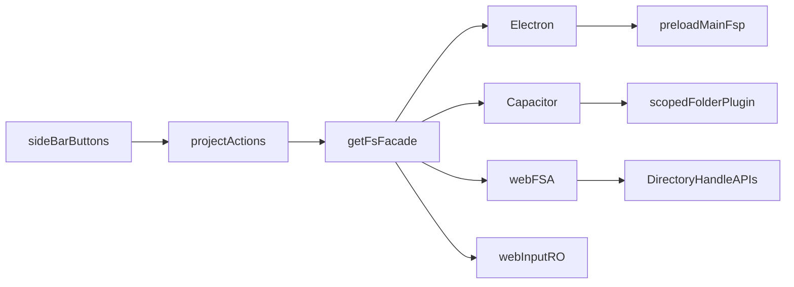

# Wire filesystem controls across targets

**Date:** 2026-10-10  
**Status:** Implemented  
**Scope:** Clarify `adapters/` vs `services/`; hook up sidebar new file / new folder / rename / delete across Electron, Capacitor, and web

---

## 0. Folder cut (do first)

Settle brainstorming vocabulary in this repo:

| From | To | Why |
|------|-----|-----|
| [`src/app/services/fs/`](../src/app/services/fs/) | [`src/app/adapters/fs/`](../src/app/adapters/fs/) | Platform backends / ports — not `hook`/`start` app services |
| [`src/app/services/drop-files.js`](../src/app/services/drop-files.js) | [`src/app/util/drop-files.js`](../src/app/util/drop-files.js) | Pure helper (no lifecycle) |

Leave in `services/`: `viewport.js`, `hotkeys.js` (`start`/`stop`).

Import touch list: `state/project`, `state/index`, `util/save`, `util/trigger-save`, `index.js`. Inside moved `drop-files.js`, fix `../util/*` → `./*`. Keep `isElectronBridge` re-export from `drop-files`.

Also update this doc’s paths, sibling brainstorming cases (`iblokz-ide.md`, `iblokz-ide-legacy.md`), and a short CHANGELOG Changed note. Verify with `pnpm run build:check`.

---

## Current shape

Targets share one facade ([src/app/adapters/fs/index.js](../src/app/adapters/fs/index.js) after §0): Electron, then Capacitor, then web, then memory. UI and project state never branch on platform; they call `getFs()` and check project-scoped `state.canWrite` / `projectAccess`.

Today that facade only covers open / list / read / write(save). Sidebar controls in [src/app/ui/side-bar.js](../src/app/ui/side-bar.js) are UI stubs with no `onClick`.

## Capability gaps

- **Electron**: create file works via `writeFile` (auto-mkdir parents); needs new IPC for `mkdir`, `rename`, `rm`
- **Capacitor**: plugin already has `mkdir` + `writeFile`; needs native `rename` + `remove`
- **Web FSA** (`canWrite`): DirectoryHandle APIs exist but are unused for mutations
- **Web input**: read-only forever — hide/disable controls when `!state.canWrite`

## Structural layers (same pattern as save)

### 1. Shared FS methods

Add identical methods on each mutating backend in [src/app/adapters/fs/](../src/app/adapters/fs/):

- `createFile(parentNode, name)` — empty text file
- `mkdir(parentNode, name)`
- `rename(node, newName)`
- `remove(node)` — file or directory (recursive)

Contract: async, return a small result or throw. Missing method means the project action no-ops.

### 2. Per-target implementation

**Electron** — [electron/util/file.js](../electron/util/file.js) + IPC in [electron/main.js](../electron/main.js) + [electron/preload.js](../electron/preload.js) + [src/app/adapters/fs/electron.js](../src/app/adapters/fs/electron.js)

**Capacitor** — expose existing `mkdir`/`writeFile` from [capacitor.js](../src/app/adapters/fs/capacitor.js); add `rename`/`remove` to `@iblokz/scoped-folder` (Android DocumentFile, iOS FileManager)

**Web FSA** — resolve parent dir handle (already used by lazy `listDir`), then create/remove; keep handle map in sync on rename

**Web input / memory** — no methods; UI gated off

### 3. Project actions

In [src/app/state/project/index.js](../src/app/state/project/index.js), mirror `saveFile`:

1. Guard `state.canWrite` and method presence
2. Call `getFs().…`
3. `refreshFilesTree(project, filesTree)`
4. Tab hygiene: close deleted paths, rewrite renamed paths, clear `pendingDeletePath`

Exports: `createFile`, `createFolder`, `renameItem`, `deleteItem`.

Defaults: root-row new file/folder target the **selected folder** (or parent of the selected file); fall back to the **project root** when nothing useful is selected. Rename/delete use `selectedPath` / `pendingDeletePath`. No rename/delete on the root node itself.

Name/confirm UX v1: `window.prompt` / `window.confirm` (same as tab discard) so web FSA stays inside a user gesture.

### 4. UI wiring

Pass `onClick` into existing `treeAction`s in [side-bar.js](../src/app/ui/side-bar.js). Hide or disable the action cluster when `!state.canWrite`.

### 5. Docs

Update README filesystem limits with a short mutation matrix; Changelog under Unreleased.

## Build order

1. **Folder cut** — `services/fs` → `adapters/fs`, `drop-files` → `util/` (§0)
2. FS API + Electron end-to-end (disk + existing watcher refresh)
3. Project actions + sidebar wiring + `canWrite` gating
4. Capacitor plugin rename/remove + adapter methods
5. Web FSA handle mutations

## Checklist

- [x] Move `services/fs` → `adapters/fs`; `drop-files` → `util/`; fix imports + brainstorming case paths
- [x] Add `createFile` / `mkdir` / `rename` / `remove` to FS backend contract
- [x] Implement Electron util + IPC + preload + `adapters/fs/electron.js`
- [x] Add project actions + `refreshFilesTree` + tab path hygiene
- [x] Wire side-bar `onClick` + `canWrite` gating + prompt/confirm
- [x] Expose Cap mkdir/create; add native rename/remove
- [x] Implement FSA handle mutations; keep input mode disabled
- [x] README FS limits matrix + CHANGELOG

**Note:** Web FSA folder rename is deferred (file rename + create/delete dirs work).

## What does not change

Backend selection order, tree UI layout (root create / selected edit / long-press delete), or the session/recent-roots model. `viewport` / `hotkeys` stay under `services/`.
