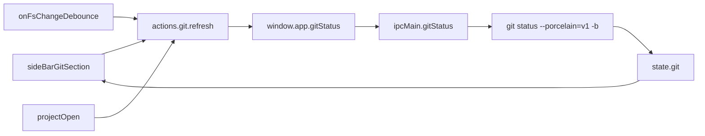

# Git status in Source Control sidebar

**Date:** 2026-10-12  
**Status:** Implemented  
**Scope:** Read-only Electron git status + recent commits in the left-pane Source Control section; refresh on project open, section switch, and debounced `fs-change`

---

## Goal

Replace the Source Control “Coming soon” placeholder with a VS Code–style dirty-file list (branch + changed paths). No stage / commit / push / diff.

## Current shape

- Section switcher already exists: `fileTree` | `search` | `git` via `layout.sideBarSection` ([`src/app/state/layout/index.js`](../src/app/state/layout/index.js), [`src/app/ui/side-bar.js`](../src/app/ui/side-bar.js)).
- `section === 'git'` renders `.side-bar-placeholder` (“Coming soon”).
- No git IPC, state slice, or parser.
- Electron already has `execFile`-friendly main process, preload `window.app`, and `onFsChange` ([`electron/main.js`](../electron/main.js), [`electron/preload.js`](../electron/preload.js), [`src/app/index.js`](../src/app/index.js)).

## Data flow



## Implementation

### 1. Electron IPC

[`electron/main.js`](../electron/main.js):

- `ipcMain.handle('gitStatus', (_ev, cwd) => …)` via `execFile('git', ['status', '--porcelain=v1', '-b'], {cwd, maxBuffer})` — fixed argv, no shell.
- Return `{ok, stdout}` or `{ok: false, error}`.
- Reject missing `cwd`; if an opened project root is tracked in main, refuse paths outside it.

[`electron/preload.js`](../electron/preload.js):

- `gitStatus: cwd => ipcRenderer.invoke('gitStatus', cwd)` on `window.app`.

### 2. Parse + bridge call

New ESM util [`src/app/util/git-status.js`](../src/app/util/git-status.js):

- Parse `-b` header (`## branch...upstream [ahead N, behind M]`) and porcelain `XY path` / rename lines.
- Map codes to short UI letters (`M`, `A`, `D`, `U`, `?`, …).

Thin caller used by state (not a full multi-backend adapter yet):

- No `window.app.gitStatus` → `{available: false}`.
- Else invoke + parse → `{available: true, branch, ahead, behind, files: [{path, index, worktree, status}]}`.

### 3. State slice

New [`src/app/state/git/index.js`](../src/app/state/git/index.js) (ESM, mirror [`file-tree`](../src/app/state/file-tree/index.js)):

```js
initial = {
  available: null,
  loading: false,
  error: null,
  branch: null,
  ahead: 0,
  behind: 0,
  files: [],
  projectPath: null
}
```

- `refresh()` — async via `dispatch`; clear / no-op without `state.project.path`; set loading then patch result.
- Export from [`src/app/state/index.js`](../src/app/state/index.js) as `git`.

Hooks:

- After successful project open / recent open → `actions.git.refresh()`.
- In [`src/app/index.js`](../src/app/index.js), debounce existing `onFsChange` (~300–500ms) → `actions.git.refresh()` when a project is open.
- Switching to section `git` triggers refresh (UI click handler or layout action wrapper).

### 4. UI + styles

[`src/app/ui/side-bar.js`](../src/app/ui/side-bar.js) — for `section === 'git'`:

- No project → keep empty explorer-style guidance.
- `!available` → “Git status requires the desktop app” (or git missing).
- Error / not a repo → short message from `state.git.error`.
- Else: branch line (+ ahead/behind) + `ul` of changed files with status letter.
- File click → open under `state.project.path` via `actions.project.openFile(...)`.
- Leave Search on placeholder.

[`src/sass/ui/_side-bar.sass`](../src/sass/ui/_side-bar.sass): compact list reusing file-list spacing; status letter via existing theme vars.

## Out of scope

- Stage / unstage / commit / push / pull / diff pane
- isomorphic-git (web / Capacitor)
- Badge count on the Source Control section icon

## Verify

- `pnpm run build:check`
- Manual (Electron): open a git repo → Source Control shows branch + dirty files; edit a file → list refreshes; click opens tab; non-Electron shows unavailable message

## Checklist

- [x] Electron `gitStatus` IPC + preload
- [x] Porcelain parser util + bridge call
- [x] `state/git` + refresh hooks (open, section, debounced fs-change)
- [x] Sidebar git panel + SASS
- [x] `pnpm run build:check`
