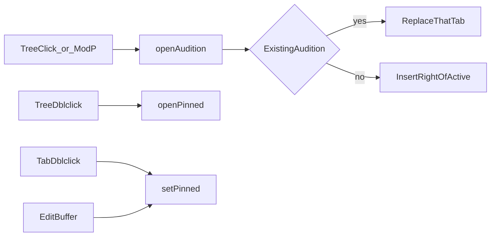

# Audition (preview) tabs + editor settings

**Date:** 2026-10-14  
**Status:** Implemented  
**Scope:** VS Code–like transient “audition” tabs; editor prefs in Electron `settings.yml` only (load via IPC); Cap/web use the same hardcoded defaults

---

## Goal

One reusable audition tab per session (italic / unpinned). Single-click tree and Mod+P audition a file; double-click tree, double-click tab, or editing pins. New audition inserts to the **right** of the active tab when no audition exists; otherwise the existing audition slot is replaced.

## Current shape

- Every open is durable: [`upsertTab`](../src/app/util/tabs.js) activates by path or appends.
- Tree / git status / Mod+P all call [`project.openFile`](../src/app/state/project/index.js) → permanent tab.
- No `pinned` / preview flag; tab strip has no dblclick-to-pin ([`ui/comp/tabs.js`](../src/app/ui/comp/tabs.js)).
- Electron [`settings.yml`](../config/settings.yml) only has `windows.singleInstance`; not exposed to the renderer.

## Behavior

| Action | Result |
|--------|--------|
| File tree single click | Audition |
| Mod+P pick | Audition |
| File tree double click | Pin (permanent open) |
| Tab double click | Pin |
| Edit buffer | Pin |
| Next audition while one exists | Replace that same tab |
| First audition (no transient) | Insert right of active |
| Session restore | Permanent (paths only; no audition flag) |

Click then double-click is fine: audition first, then pin (VS Code-like).



## Settings (YAML only)

Extend [`config/settings.yml`](../config/settings.yml) and `DEFAULTS` in [`electron/util/settings.js`](../electron/util/settings.js):

```yaml
editor:
  enablePreview: true
  enablePreviewFromQuickOpen: true
  openPositioning: right
```

VS Code defaults. Edit user `settings.yml` + restart; no renderer localStorage for these keys.

- Document in [`docs/storage.md`](../docs/storage.md).
- Expose merged settings: `getSettingsSync` / `getSettings` IPC + [`electron/preload.js`](../electron/preload.js) on `window.app` (same pattern as host theme).
- Renderer helper (e.g. `src/app/util/app-settings.js`): bridge when present; else same hardcoded defaults (web / Cap).
- `enablePreview: false` → all opens pin. `enablePreviewFromQuickOpen: false` → Mod+P pins.

## State impact

**Root shape unchanged.** Still `state.tabs: Tab[]` and `state.activeTabId`. No new top-level slice. Settings are **not** mirrored into app state — read once from YAML/IPC (or hardcoded defaults) in open helpers.

**Per-tab addition only:**

```js
// today
{ id, file, source, type, indent, dirty, … }

// after
{ id, file, source, type, indent, dirty, …, pinned: true | false }
```

| Field / mirror | Change |
|----------------|--------|
| `tabs[].pinned` | New. `false` = audition; `true` = permanent. Default `true` for session restore / explicit pin opens. |
| `tabs` order | Audition insert may place mid-list (right of active), not only append. Replace mutates one existing index instead of `concat`. |
| `activeTabId` | Same semantics; still projects mirrors via `projectActive` (`file`, `source`, `dirty`, …). |
| Root mirrors | Unchanged — still derived from the active tab. |
| Session (`localStorage`) | Unchanged — still `tabPaths` + `activePath` only. Audition flag is **not** persisted; restore opens as pinned. |
| Layout / preview / git / fileTree | Untouched. |

**Invariant:** at most one tab with `pinned === false` at a time (when preview is enabled). Pin flips that flag in place; replace swaps `file`/`source`/… on the audition tab (new `id` if id === path).

**Actions** live in `state/tabs/index.js` (re-exported from `state/index.js`):

- `openTab` — used by `openFile` / `loadFile` / `loadImage` (audition vs pin)
- `pinTab` — tab dblclick and first edit
- `closeTab` / `nextTab` / `prevTab` / `setActiveTab` — moved here; behavior unchanged aside from closing an audition

## Module split (util vs state)

**Do not put action reducers in `util/`.** Match file-tree / git: util = pure data helpers; state slice = [`state/tabs/index.js`](../src/app/state/tabs/index.js).

| Lives in | Examples |
|----------|----------|
| [`util/tabs.js`](../src/app/util/tabs.js) | `createTextTab` / `createImageTab`, `empty*`, `findTabIndex*`, `newTabId`, `projectActive` / `activeTab` reads |
| **[`state/tabs/index.js`](../src/app/state/tabs/index.js)** (new) | `openTab`, `pinTab`, `activateTabId`, `closeTab`, `nextTab` / `prevTab` — audition replace / insert-right; re-export actions flat from [`state/index.js`](../src/app/state/index.js) (**not** nested as `tabs` — that key is the tab array) |

Migrate existing tab actions out of [`state/index.js`](../src/app/state/index.js) into this slice as part of the work. Prefs defaults stay in `config/settings.yml` / `DEFAULTS`, not in util.

## Implementation

### 1. Tab model — [`state/tabs/index.js`](../src/app/state/tabs/index.js)

- Add `pinned: true|false` on tab objects (`createTextTab` / `createImageTab` default pinned unless caller passes audition).
- Reducers `openTab` / `pinTab` (and moved `setActiveTab` / `closeTab` / cycle):
  - Path already open → activate; if `mode === 'pinned'`, set `pinned: true`.
  - Audition + existing unpinned tab → replace in place (revoke image URL if needed).
  - Audition + no unpinned → insert at `activeIndex + 1` when `openPositioning === 'right'`.
  - Pinned open → insert/append with `pinned: true`.

Wire [`loadFile` / `loadImage` / `openFile`](../src/app/state/project/index.js) through `tabs.openTab` with a mode arg (default audition when prefs allow).

### 2. Gestures + UI

- [`side-bar.js`](../src/app/ui/side-bar.js): click → audition; file dblclick → pin. Git status single click → audition.
- [`file-search.js`](../src/app/ui/comp/file-search.js): pick → audition (or pin per pref).
- [`tabs.js`](../src/app/ui/comp/tabs.js): tab dblclick (not close) → pin; `.is-audition` when `!pinned`.
- [`_header.sass`](../src/sass/ui/_header.sass): italic / muted for `.is-audition`.
- Editor dirty path ([`state/editor`](../src/app/state/editor/index.js)): unpinning → pin on edit.

### 3. Docs / changelog

- [`docs/storage.md`](../docs/storage.md) keys + short audition note.
- `[Unreleased]` in `CHANGELOG.md` when implementing.

## Out of scope

- Settings UI / in-app editor for YAML keys.
- Persisting audition flag across sessions.
- Split editor groups / multiple audition slots.
- Alt+Enter / open-to-side from Mod+P.
- Changing Cap/web storage model beyond hardcoded defaults.
