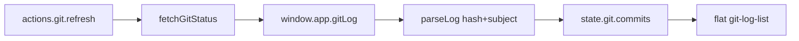
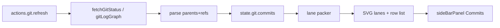

# Commits panel → git graph panel

**Date:** 2026-10-27  
**Status:** Phase 1–4 mostly done (select/expand + hover polish)  
**Scope:** Expand Source Control **Commits** bottom panel into a topology/graph view (lanes + decorations). Electron-only; read-only at first. Builds on [git status sidebar](./2026-10-12-01-git-status-sidebar.md) and the collapsible Commits panel in `ui/side-bar/git/`.

---

## Goal

Replace (or evolve) the flat recent-commit list into a VS Code–style history graph: dots/lanes for parent links, branch/tag decorations, still hosted in the existing resizable Commits panel.

No stage / commit / push required for the first cut. Click-to-inspect (`git show` / file list) is a later phase.

---

## Current shape

| Piece | Today |
|-------|--------|
| IPC | `gitLog` → `git log -n 30 --format=%h%x09%s` ([`electron/main.js`](../electron/main.js)) |
| Parse | `{hash, subject}` only ([`src/app/util/git-status.js`](../src/app/util/git-status.js) `parseLog`) |
| State | `state.git.commits` ([`src/app/state/git/index.js`](../src/app/state/git/index.js)) |
| UI | Flat `ul.git-log-list` inside `sideBarPanel` “Commits” ([`src/app/ui/side-bar/git/index.js`](../src/app/ui/side-bar/git/index.js)) |
| Panel chrome | Collapse chevron + vertical gutter; `layout.toggles.gitCommits` / `dim.gitCommits` |



---

## Target data

Richer log (parents + decorations), e.g.:

```bash
git log -n N --topo-order --decorate=short \
  --format='%h%x09%p%x09%D%x09%s'
```

Parsed nodes:

```js
{
  hash: string,
  parents: string[],  // from %p
  refs: string[],     // from %D (HEAD, branches, tags)
  subject: string
}
```

Optional later: author/date, `--all` vs current branch only, larger `N`, separate `git for-each-ref` for tips.

Bridge options:

- Extend existing `gitLog` argv + widen `parseLog`, **or**
- Add `gitLogGraph` IPC to keep the flat format available.

---

## Layout algorithm

Turn parent links into **lanes** (columns):

1. Rows = topo order from git (already `--topo-order`).
2. Assign each commit a lane so merge/fork edges don’t collide.
3. Emit drawable segments: verticals, horizontals, merges, forks, commit dots.

Ship as a small util (e.g. `src/app/util/git-graph-layout.js`) — no dependency required for a minimal “main + few branches” packer.

---

## Rendering options

| Approach | Effort | Notes |
|----------|--------|--------|
| ASCII / `git log --graph` prefix | Small | Hard to theme; keep as spike only |
| **SVG/canvas lane column beside the list** | Medium | Preferred first UI |
| Full interactive canvas (pan/zoom) | Large | Overkill for sidebar |

Preferred: keep the row list (hash + subject + ref chips); add a fixed-width SVG gutter of lanes/dots on the left.

---

## UI wiring

- Keep panel shell (`side-bar/panel.js`); title stays **Commits** or becomes **Graph**.
- Extract list/graph into `side-bar/git/graph-panel.js`.
- Leave **Changes**, Explorer, and dirty-diff gutter alone.
- Refresh still via `actions.git.refresh()`; existing `stamp` can invalidate caches if needed.



---

## Phases

### Phase 1 — Richer log (still flat UI)

- [x] IPC: parents + decorations in log format
- [x] `parseLog` → `{hash, parents, refs, subject}`
- [x] State/UI still list-only (refs optional chips)

**Done when:** commits in state carry parents/refs; UI unchanged or chips only.

### Phase 2 — Lane layout + SVG column

- [x] `git-graph-layout` util (lanes + edge segments)
- [x] SVG gutter in Commits panel body
- [x] Style with theme vars (accent / muted / danger sparingly)

**Done when:** merges/forks readable in the sidebar panel; resize/collapse still work.

### Phase 3 — Decorations polish

- [x] HEAD / branch / tag chips
- [x] Current-branch emphasis
- [x] Empty / non-repo / loading states unchanged in meaning

### Phase 4 — Interactions (optional)

- [x] Select commit (highlight)
- [x] `git show` / changed-files for selection (expand + hover card)
- [ ] Open file at revision (stretch goal)

---

## Non-goals (first cut)

- Staging, commit, push, pull, rebase UI
- Replacing Changes panel
- Full `--all` multi-remote graph unless Phase 1 explicitly opts in
- Canvas pan/zoom editor

---

## Risks / notes

- Lane packing gets messy with many concurrent branches — cap `N` (e.g. 50–100) and/or `--first-parent` escape hatch.
- `%D` decorations can be noisy; sanitize and prioritize HEAD + local branches.
- AppImage/preload: new or changed IPC needs Electron restart / redeploy (same as `gitShow`).
- Keep max panel height generous (already raised for Commits) so the graph is usable.
